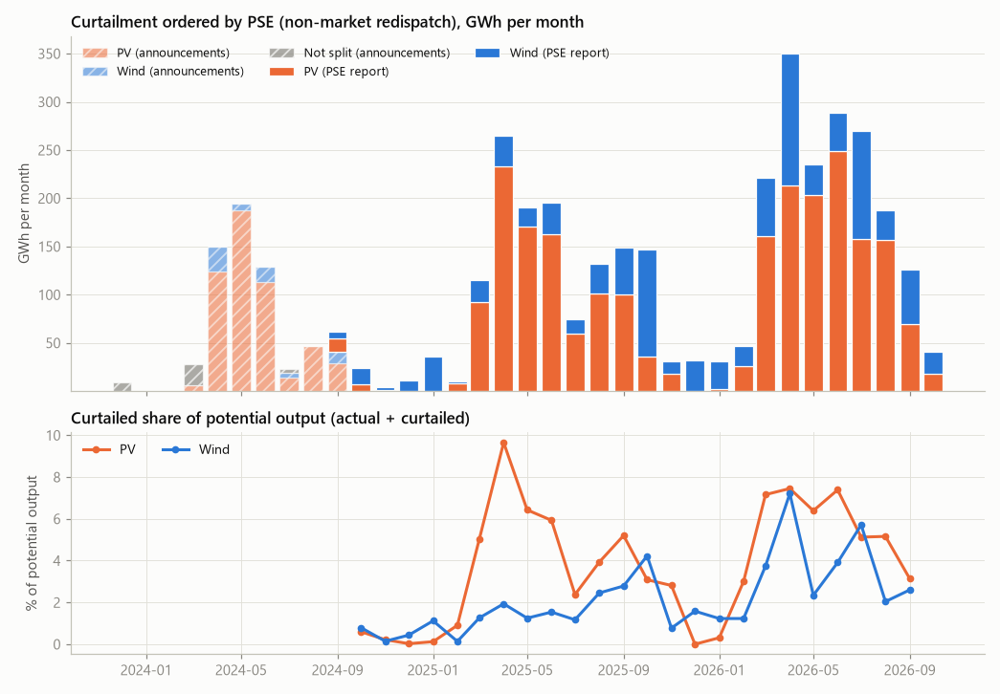
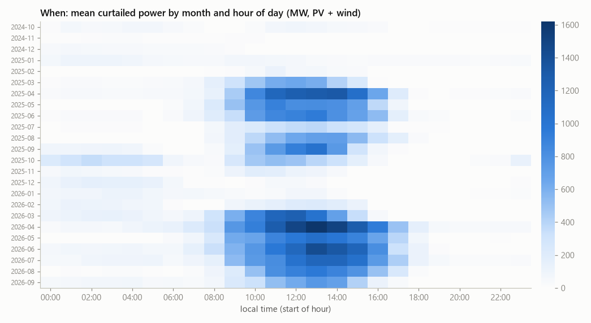
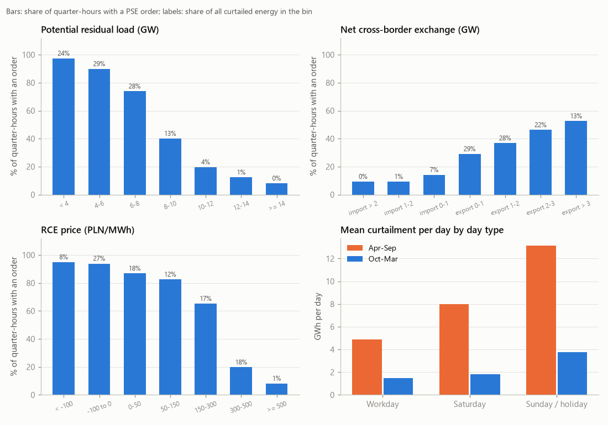
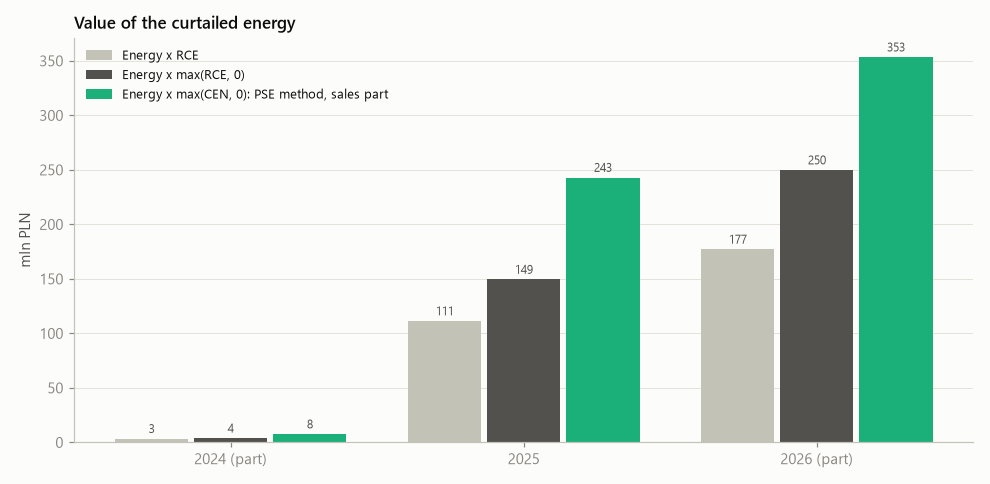
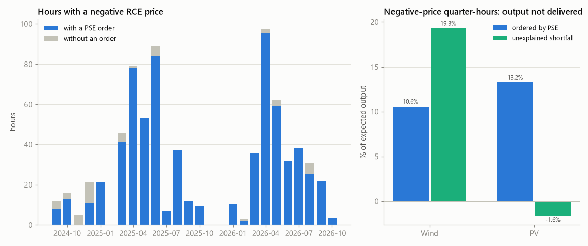

# pl-res-curtailment

[](https://github.com/kwwaleszczynski-del/pl-res-curtailment/actions/workflows/ci.yml)

How much solar and wind power does PSE, the Polish transmission system operator, curtail through **non-market
redispatch**, when does it happen, why, and what is the curtailed energy worth? This project builds a transparent
tracker from public data only: PSE's quarter-hourly report of curtailment orders (since 24 September 2024), PSE's
earlier text announcements (December 2023 to September 2024), demand, generation, cross-border exchange and prices,
and the regulator's annual figures.

**Dashboard:** <https://kwwaleszczynski-del.github.io/pl-res-curtailment/> (static Plotly page, rebuilt weekly when
the schedule is switched on, see [Automation](#automation)).



## Key results

Data to 25 October 2026 (`results/summary.json`). Volumes are the reductions PSE ordered; "share" is curtailed
energy divided by actual plus curtailed output.

| Year | PV GWh | Wind GWh | Total GWh | PV share | Wind share | Days with orders | Value at RCE >= 0, mln PLN | CEN-based estimate, mln PLN |
|---|---:|---:|---:|---:|---:|---:|---:|---:|
| 2024 (from 24 Sep) | 21.8 | 38.8 | 60.6 | 1.0% | 0.5% | 22 | 3.8 | 7.6 |
| 2025 | 982.4 | 395.1 | 1,377.5 | 4.9% | 1.8% | 266 | 149.4 | 242.9 |
| 2026 (to 25 Oct) | 1,256.9 | 540.5 | 1,797.4 | 5.5% | 3.1% | 223 | 249.8 | 353.4 |

- **Trend.** January to September 2026: 1,757 GWh against 1,168 GWh a year earlier (+50%; PV +33%, wind +116%),
  while the number of hours with an order fell by 24%: fewer, deeper curtailments. The 12-month sum grew from
  1,207 GWh (to September 2025) to 1,967 GWh (to September 2026). The busiest month so far was April 2026 (350 GWh).
- **Before the report.** PSE's announcements give 520 GWh of PV, 66 GWh of wind and 35 GWh with the technology not
  stated between December 2023 and 23 September 2024. With the report this covers 91% of the PV and 84% of the wind
  volume that URE lists for TSO orders in 2024 (597 GWh PV, 125 GWh wind); in 2023 URE lists 24 GWh PV and 42 GWh wind.
- **Why.** 98% of the volume is curtailment for balancing the system (a surplus of generation over demand and
  exports); orders for network constraints add 59 GWh (1.8%) since September 2024 and mostly fall at positive prices.
- **When.** Potential residual load (demand minus PV and wind before curtailment) below 8 GW occurs 15% of the time
  and holds 81% of the curtailed energy; below 4 GW an order was in force in 97% of quarter-hours. 92% of the energy
  was curtailed while Poland was a net exporter; with exports above 3 GW an order was in force 53% of the time.
  Quarter-hours in which potential PV covers at least half of demand (9% of the time) hold 57% of the energy.
- **Weekends and holidays.** From April to September a Sunday or public holiday averages 13.1 GWh of curtailment,
  a Saturday 8.0 GWh and a workday 4.9 GWh. The record day is Easter Sunday 2026 (5 April): 52.2 GWh, with up to
  5.4 GW curtailed in a quarter-hour; Easter Monday 2026 follows with 44.2 GWh.
- **Value.** At the RCE market price the curtailed energy was worth 111 mln PLN in 2025 (149 mln PLN with negative
  prices set to zero) and 177 mln PLN (250 mln PLN) in 2026 to 25 October. The sales part of the compensation as PSE
  describes its method (energy times the imbalance price CEN, zero when CEN <= 0) adds up to 243 and 353 mln PLN: CEN
  was positive for 46% of the curtailed energy and then usually above RCE; CEN above 1,000 PLN/MWh, in 0.7% of
  the energy, makes 16% of that figure. This is an estimate of a formula, not of what was paid.
- **Negative prices.** PSE orders were in force in 94% of the 2,966 quarter-hours with a negative RCE price (97% in
  2025 and 2026), but only 15% of the quarter-hours with an order had a negative price: 35% of the curtailed energy
  (1,114 of 3,235 GWh). Most ordered curtailment happens at positive day-ahead prices.
- **Voluntary curtailment.** In negative-price quarter-hours wind output fell 17-20% below the output expected from
  PSE's day-ahead plan beyond what PSE ordered: about 517 GWh (425-546 GWh across method variants) since September
  2024, next to 284 GWh ordered by PSE in the same quarter-hours. This is a lower bound: the plan is published after
  the day-ahead auction, so reductions already scheduled there are not counted. For PV the estimate is not identified: in
  positive-price quarter-hours with an order, actual plus curtailed PV was already 6% above the expectation, so
  voluntary switching-off cannot be separated from forecast error.









## Data

All series come from the PSE reports API (`https://api.raporty.pse.pl`) through
[pse-opendata](https://pypi.org/project/pse-opendata/) (from PyPI, `pse-opendata>=0.2,<0.3`), which
caches whole months as Parquet files in `data/` and downloads a month again until its revision window has passed.

| Report | Fields used | Resolution | From | Notes |
|---|---|---|---|---|
| `poze-redoze` Non-market redispatch of RES | `pv_red_balance`, `pv_red_network`, `wi_red_balance`, `wi_red_network` (MW) | 15 min | 2024-09-24 | Reduction is negative, an empty value means no order. Published before or during the day (the report for 26 October 2026 was online at 23:00 the day before) and corrected later (up to about 70 days), so the volumes are orders, not metered lost energy. |
| `his-wlk-cal` Fundamental data | `demand`, `pv`, `wi`, `swm_p`, `swm_np` (MW) | 15 min | 2024-06-14 | Actual output after curtailment; PV includes rooftop systems. Exchange balance: + import, - export. |
| `rce-pln` Market price RCE | `rce_pln` (PLN/MWh) | 15 min | 2024-06-14 | Hourly product until 30 September 2025 (the hourly price repeats in four quarter-hours). |
| `crb-rozl` Balancing prices | `cen_cost` (PLN/MWh) | 15 min | 2024-06-14 | Imbalance price CEN, published about a day later and revised with settlements. |
| `pdgopkd` Day-ahead coordinated plan | `gen_fv`, `gen_wi` (MW) | 15 min | 2024-06-14 | PSE's planned PV and wind output; used only as the expectation for the voluntary-curtailment estimate. |

**PSE announcements.** Until the report started, PSE published each curtailment as a text announcement on
[www.pse.pl](https://www.pse.pl/informacje-o-pracy-systemu-elektroenergetycznego) ("Komunikat o nierynkowym
redysponowaniu jednostek wytwórczych ... w KSE w dn. ...") with the ordered MW for each hour, often updated several
times a day. `pl_res_curtailment.announcements` pages through the list, drops struck-through (superseded) values,
reads three ways of writing the hourly values and keeps the last version of each day and technology. The result
ships in the package ([hourly table](src/pl_res_curtailment/data/announcements_hourly.csv): 52 days from
25 December 2023 to 24 September 2024; [events without volume](src/pl_res_curtailment/data/announcements_events.csv):
press releases of 2022-2023 and two orders stated as installed capacity or as a daily estimate). On 24 September 2024,
the day the two sources overlap, the announcement (817, 1,042, 884 MW) matches the report (817, 1,042, 883 MW).
`python -m pl_res_curtailment announcements` rebuilds the tables; the analysis never needs the website. PSE no longer
publishes such announcements; other reports of the API (`ogr-*`) list network constraints of individual units and are
deliberately not used, because this project does not point at specific installations.

**URE reports.** The regulator's annual summaries of the redispatch reports
([2023](https://www.ure.gov.pl/download/9/15075/Sprawozdanie-redysponowanie.pdf),
[2024](https://www.ure.gov.pl/download/9/15780/Sprawozdaniedotredysponowaniaza2024r.pdf)) give the TSO and DSO
volumes per year; they are transcribed in `src/pl_res_curtailment/reference.py` and used as a cross-check. The 2025
summary was not published when this was written. Curtailment ordered by DSOs on their own account (24 GWh PV and
2.8 GWh wind in 2024) is not in the PSE data.

## Method

For quarter-hour $`t`$, the curtailed power of a technology is the sum of the two PSE fields (balancing and network
constraints), $`C_t = P^{\mathrm{bal}}_t + P^{\mathrm{net}}_t \ge 0`$ in MW. Energy over a period $`K`$ and the share
of potential output, with $`G_t`$ the actual output:

```math
E_K = \frac{1}{4}\sum_{t \in K} C_t, \qquad
s_K = \frac{\sum_{t \in K} C_t}{\sum_{t \in K} \left(G_t + C_t\right)}
```

**Drivers** are conditional frequencies: for bins of a variable $`x`$ (potential residual load
$`D_t - (G^{\mathrm{PV}}_t + C^{\mathrm{PV}}_t) - (G^{\mathrm{W}}_t + C^{\mathrm{W}}_t)`$ with demand $`D_t`$, net exports, RCE, demand,
potential PV as a share of demand) the share of quarter-hours with an order and the share of all curtailed energy in
the bin. Day types use the Polish statutory holidays (24 December from 2025 on).

**Value** of the curtailed energy at the RCE price $`p_t`$, with negative prices kept or set to zero, and the sales part
of the compensation as described for PSE's method, with the imbalance price $`c_t`$:

```math
V_{\mathrm{RCE}} = \sum_t \frac{C_t}{4}\, p_t, \qquad
V^{+}_{\mathrm{RCE}} = \sum_t \frac{C_t}{4} \max(p_t, 0), \qquad
V^{+}_{\mathrm{CEN}} = \sum_t \frac{C_t}{4} \max(c_t, 0)
```

**Voluntary curtailment at negative prices.** PSE's day-ahead plan $`\hat{G}^{\mathrm{plan}}_t`$ gives the output PSE
expected. Its bias is removed with the ratio of actual to planned output in a baseline $`B(t)`$ of comparable
quarter-hours with $`p \ge 0`$ and no order (same month and hour in the central variant; season, hour and plan level
in the others):

```math
\hat{G}_t = \hat{G}^{\mathrm{plan}}_t \, \frac{\sum_{u \in B(t)} G_u}{\sum_{u \in B(t)} \hat{G}^{\mathrm{plan}}_u},
\qquad S_t = \hat{G}_t - G_t - C_t
```

The shortfall $`S_t`$ summed over negative-price quarter-hours is output that was neither delivered nor ordered:
market participants switching off on their own, plus forecast error.

The plan is not an unconstrained expectation. PSE publishes the coordinated plan (PKD) for day D on D-1 after the
day-ahead (SDAC) auction has cleared: over the 840 days from 14 June 2024 to 30 September 2026 the first
publication reported by the API came between 15:13 and 20:30 local time (median 15:47; measured in
[pl-forecast-bench](https://github.com/kwwaleszczynski-del/pl-forecast-bench)), against market results at about
13:00. If the plan already includes reductions that wind and PV operators scheduled in the day-ahead market for
negative prices, those are not in the shortfall, so the voluntary figure is a lower bound for all price-driven
curtailment; it measures what was switched off beyond the plan, for example intraday or in real time. Whether and
how PSE's plan includes such schedules is not documented in the data and is to be verified. As a placebo, the same shortfall in
positive-price quarter-hours with an order cannot be voluntary; the range reported combines four baselines with and
without subtracting the placebo share. Wind passes this check (placebo +1%), PV does not (placebo -6%: curtailment is
ordered when PV beats the forecast, and the ordered volume need not equal the energy actually lost).

## Compensation rules (context, to verify)

Read on 26 October 2026 from the sources linked. The law and PSE's procedures change often; check the current texts
before relying on any of this. **This is not legal advice.**

- **EU.** [Regulation (EU) 2019/943](https://eur-lex.europa.eu/legal-content/EN/TXT/?uri=CELEX:02019R0943-20240716),
  Art. 13: non-market redispatch only where no market-based alternative is available, all market-based resources
  have been used, too few facilities are available for effective competition, or congestion is regular and
  predictable (para. 3); renewables are redispatched downwards only if no other alternative exists or other
  solutions would result in significantly disproportionate costs or severe risks to network security (para. 6);
  non-market redispatch is financially compensated by the operator that requests it, at least at the higher of the
  additional operating cost and the net day-ahead revenues the facility would have earned, including volume-based
  support, except for producers whose connection agreement gives no guarantee of firm delivery (para. 7); operators
  report reasons, volumes and measures to the regulator at least yearly (para. 4).
- **Poland.** The Energy Law (Prawo energetyczne), Art. 9c(7a): the TSO may order wind and solar units to switch off or
  reduce output in the cases of Art. 13(3) and on the principles of Art. 13(6) of the Regulation, subject to the
  compensation of Art. 13(7); units without active power control (Art. 9c(7f)) are curtailed for balancing only in a
  threat to security of supply; the yearly report to URE is due by 1 March (Art. 9c(7q)). These rules came with the
  amendment of 28 July 2023 (Dz.U. 2023 poz. 1681, in force since 7 September 2023); until the grid code (IRiESP) sets
  detailed rules, compensation is calculated and paid under a contract (Art. 30(5) of that act).
- **PSE's method**, as described in the
  [Minister of Energy's reply to interpellation 11689](https://api.sejm.gov.pl/sejm/term10/interpellations/attachment/ATTDLZHXH/i11689-o1.pdf)
  (24 September 2025): the sales part is the energy not produced times CEN (CRO before 14 June 2024) for each
  quarter-hour, zero when the price is at or below zero; the support part follows the scheme (the auction CfD
  settlement against the daily TGeBase index, or the certificate price at the first TGE session after the day);
  prices of sales contracts (PPAs) are not used. Owners apply through PSE's portal (PV since October 2024, wind since
  May 2025); see PSE's [conditions of the application](https://www.pse.pl/documents/20182/4168830618/Warunki_skladania_Wniosku_o_rekompensate.pdf).
  Since 24 June 2025 PSE ranks units by their average relative redispatch coefficient to spread curtailment more
  evenly.

The value figures above are therefore a system-level order of magnitude: the support part cannot be estimated from
public data, and compensation is paid per unit, on application and after verification with the DSO.

## Limitations

- Volumes are PSE's orders as published in the report, not metered energy, and the report is revised for weeks.
- The PV share uses all PV output in the denominator, including rooftop systems that are never curtailed; for
  curtailable PV farms the share is higher.
- Announcements before 24 September 2024 are ordered hourly MW in their last published version; a few orders were
  announced without hourly values (listed as events) and some days do not state the technology.
- The voluntary-curtailment estimate relies on PSE's day-ahead plan as the expected output; it is an indication of
  scale for wind, a lower bound if the plan already includes reductions scheduled in the day-ahead market, and not
  identified for PV.
- Only TSO-ordered, system-level data are used; nothing here identifies or concerns individual installations.

## Usage

Python 3.11 or newer.

```bash
python -m venv .venv
.venv/Scripts/python -m pip install -e ".[dev]"          # Linux/macOS: .venv/bin/python
python -m pl_res_curtailment fetch                         # download / refresh the PSE cache in ./data
python -m pl_res_curtailment report                        # tables in results/, README figures in docs/img/
python -m pl_res_curtailment dashboard --out docs          # static dashboard in docs/index.html
python -m pl_res_curtailment report --offline --end 2026-10-25   # rebuild from the cache, fixed last day
python -m pl_res_curtailment announcements                 # re-parse PSE's 2023-2024 announcements
pytest -q                                                  # offline tests on synthetic data
```

The last day analysed is yesterday (Europe/Warsaw) unless `--end` is given. Exit code 2 means no redispatch or system
data were available and nothing was written.

## Automation

`.github/workflows/dashboard.yml` rebuilds the dashboard from the API every Monday at 06:30 UTC and deploys `docs/`
to GitHub Pages (Settings > Pages > Source = "GitHub Actions"). The schedule is **off** until the repository variable
`DASHBOARD_SCHEDULE` is set to `on`; a manual run (workflow_dispatch) always builds. The PSE cache is kept between
runs with `actions/cache`; nothing is committed by the workflow. `.github/workflows/ci.yml` runs the tests on Python
3.11 and 3.12.

## Data source and terms of use

Data: information obtained from www.pse.pl (PSE S.A. public reports `poze-redoze`, `his-wlk-cal`, `rce-pln`,
`crb-rozl`, `pdgopkd` of the reports API, and announcements published on www.pse.pl), state as of 26 October 2026.
The information has been processed in whole or in part: aggregated, combined with other series and, for the
announcements, parsed from text. It is not an official PSE publication.

PSE publishes conditions for re-using public sector information
([BIP, "Ponowne wykorzystywanie informacji sektora publicznego"](https://www.pse.pl/bip/ponowne-wykorzystanie-informacji-publicznej),
entry changed on 14 October 2026, checked on 26 October 2026). They allow commercial and non-commercial re-use free of
charge on condition that the source and the date the information was obtained are named, the PSE logo is removed,
unchanged information is kept unchanged and, when processed information is passed on, recipients are told that it was
changed and how, without being misled. PSE accepts no liability for processed information. The conditions are written
for www.pse.pl; the reports API is run by the same operator. This repository contains processed PSE information only:
the parsed announcement tables, the aggregated tables in `results/` and `docs/`, and the figures. Raw API data are not
committed (`data/` is ignored).

URE figures come from URE's public annual reports; the legal context quotes public legal acts and a public reply of
the Minister of Energy to a parliamentary interpellation. Nothing here is legal, tax or investment advice.

## License

Code: MIT, see [LICENSE](LICENSE). Data: see [Data source and terms of use](#data-source-and-terms-of-use).
